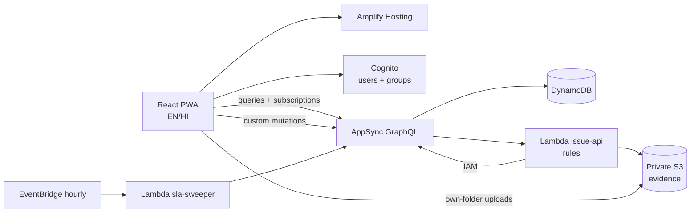

# FixLoop

**Scan it. Report it. Track it. Verify the fix.**
QR-first maintenance for Indian campuses: every water cooler, washroom, fan and light gets a QR identity; students report in seconds (Hindi or English); duplicates merge automatically; staff must attach repair evidence; and **only the reporter can close the issue**.

Built for **Techfest IIT Bombay 2026-27 · Campus to Cloud Hackathon sponsored by AWS**. Serverless on AWS (ap-south-1).

| | |
|---|---|
| **Live prototype** | *Pending deployment.* See [Deployment status](#deployment-status) |
| **Idea brief** | [docs/IDEA_BRIEF.md](docs/IDEA_BRIEF.md) |
| **AWS build summary** | [docs/AWS_BUILD_SUMMARY.md](docs/AWS_BUILD_SUMMARY.md) |
| **Demo script** | [docs/DEMO_SCRIPT.md](docs/DEMO_SCRIPT.md) |

---

## Why
Campus complaints today go to WhatsApp groups and registers. Nobody tracks them, ten people report the same cooler, and "fixed" is declared by the person who fixed it. The same asset fails again and nobody remembers. FixLoop closes that loop. Evidence and sources: [docs/RESEARCH_REPORT.md](docs/RESEARCH_REPORT.md).

## Features

**Students** (mobile-first PWA, no install)
- Scan a QR (in-app camera scanner, or the phone camera via the URL) or type the asset code.
- See the asset, its location and problems **already reported**; confirm instead of duplicating.
- Report in two taps: choose the problem, add an optional photo (compressed on the phone), flag a safety hazard.
- Track status, timeline and repair evidence; **verify the fix or reopen it**; rate the service.
- Full Hindi/English interface, including sign-in.

**Maintenance staff**
- Live department queue sorted by transparent priority, with SLA countdowns.
- Accept · decline (with reason) · start · resolve (remarks + **mandatory repair photo**).
- "Awaiting verification" and history views.

**Administrators**
- Live dashboard: active/overdue issues, median accept and repair times, verified-closure rate, duplicates consolidated, status pipeline, 14-day trend, department performance, building × department hotspots, most common problems, **repeat-failure assets**, student feedback.
- Triage: reassign departments, mark false reports invalid (audited).
- Asset registry with health scores and **printable bilingual QR labels**.
- Invite staff and admins (Cognito invitations).
- Labelled **DEMO DATA** loader/cleaner and CSV export of pilot metrics.

**Engine** (server-side, unit-tested)
- **Duplicate consolidation:** same asset + same problem + still active = one issue, enforced with a DynamoDB conditional lock; one confirmation per person.
- **Transparent priority (0–100):** severity 40 · problem type 15 · confirmations 20 · waiting vs target 20 · asset criticality 12 · failed fixes 10, with bands P1–P4.
- **State machine:** OPEN → ACKNOWLEDGED → IN_PROGRESS → RESOLVED → CLOSED / REOPENED, plus DECLINE→triage, REASSIGN, INVALID, and auto-close as `CLOSED_UNVERIFIED` after 72 h.
- **Hourly SLA sweep** (EventBridge): escalation, re-scoring, auto-close.
- **Asset intelligence:** MTBF, verified repairs, last service, and rules such as "≥3 faults in 90 days → preventive maintenance". No predictive claims.

## Architecture



Details and rationale: [docs/ARCHITECTURE.md](docs/ARCHITECTURE.md) · Data model: [docs/DATABASE_SCHEMA.md](docs/DATABASE_SCHEMA.md) · Security and cost: [docs/AWS_COST_AND_SECURITY.md](docs/AWS_COST_AND_SECURITY.md)

**Stack:** React 19 · TypeScript · Vite 7 · Tailwind CSS 4 · AWS Amplify Gen 2 (Cognito, AppSync, DynamoDB, Lambda, S3, EventBridge, CloudWatch) · Vitest.

## Repository layout
```
amplify/   backend as code: auth, data (schema + auth rules), storage, Lambda functions
shared/    pure domain logic shared by Lambda and browser (catalog, priority, workflow, dedupe, analytics)
src/       React app: pages for student, staff and admin
tests/     Vitest suites (domain, service with in-memory repo, Lambda boundary)
scripts/   whoami, bootstrap-admin, production smoke test
docs/      research, selection, architecture, submission documents
```

## Run it locally
```bash
npm ci
npx ampx configure profile --name fixloop     # IAM user access key: see docs/DEPLOYMENT.md
npx ampx sandbox --profile fixloop            # deploys a personal AWS backend, writes amplify_outputs.json
npm run dev                                   # http://localhost:5173
```
Then create the first admin:
```bash
AWS_PROFILE=fixloop node scripts/bootstrap-admin.mjs --email you@college.ac.in --name "Your Name"
```
FixLoop has **no mock mode**. Without `amplify_outputs.json` the app shows a "Backend not connected" screen.

### Environment configuration
- The web app needs **no secrets**: `amplify_outputs.json` (git-ignored) holds only public IDs and the API URL, and is generated by the sandbox or by Amplify Hosting.
- Script variables are listed in [`.env.example`](.env.example).

## Deploy
Amplify Hosting connected to this repo runs [`amplify.yml`](amplify.yml): `npm ci` → **`npm test`** → `ampx pipeline-deploy` → `npm run build`. Step-by-step guide (Free-plan-safe IAM setup, the SPA rewrite for QR links, smoke test): **[docs/DEPLOYMENT.md](docs/DEPLOYMENT.md)**.

### Deployment status
| Item | Status |
|---|---|
| Backend definition | ✅ Typechecks; **offline CDK synthesis succeeds** (no circular dependencies; IAM reviewed) |
| Frontend | ✅ Typechecks; production build succeeds |
| AWS deployment | ⏳ Not yet deployed: waiting for AWS credentials on the dev machine |
| Live URL | — (will be added here only after it is verified) |

## Testing
```bash
npm test            # 64 tests
npm run typecheck   # app + backend TypeScript
npm run build       # production bundle
SMOKE_URL=https://<live-url> node scripts/smoke.mjs   # after deployment
```

**Automated coverage of the required scenarios**

| Requirement | Where it's tested |
|---|---|
| QR identification | `catalog-validation.test.ts` (URL/code parsing, rejects foreign QR); `service.test.ts` (unknown or retired asset) |
| New issue creation + department assignment | `service.test.ts` › *creates an issue routed to the correct department* |
| Duplicate issue confirmation | `service.test.ts` › *duplicate consolidation* (5 tests incl. one-person-one-vote and reopen-on-report) |
| Correct prioritisation | `priority.test.ts` (formula, caps, bands, SLA); `service.test.ts` (confirmations and reopen raise priority) |
| Role-based authorization | `service.test.ts` › *staff workflow and role-based authorization*; admin-only operations |
| Staff status updates | ACCEPT/START/RESOLVE transitions, illegal transitions rejected, optimistic-concurrency race |
| Evidence uploads | photo key validation, object must exist, size and type limits, evidence required on RESOLVE |
| Resolution verification + reopening | `service.test.ts` › *resolution verification* (only reporters/confirmers; reopen resets SLA) |
| Analytics calculations | `analytics.test.ts` (totals, medians, SLA, departments, verification and reopen rates, asset rules) |
| Unauthenticated access | `service.test.ts` + `handler.test.ts` (no identity → `UNAUTHENTICATED`; IAM/guest callers rejected); `smoke.mjs` against production |
| API error handling | `handler.test.ts` (error codes; internal details hidden) |
| Demo-data labelling | `catalog-validation.test.ts`, `service.test.ts` (load/clear never touches real data) |
| Mobile responsiveness | Manual: checked at 375 px (no horizontal scroll; bottom navigation) |
| Production smoke test | `scripts/smoke.mjs` (run after deploy) |

Mutation check: removing the evidence requirement or the reporter-only verification rule each makes exactly the right test fail.

**Manual checklist after deploy:** scan a printed label with a phone camera · report with a photo on 4G · confirm from a second account · staff accept → resolve with a photo · reporter verifies and reopens · admin dashboard updates without refresh · Hindi toggle on every page · sign-out and role-guarded pages.

## Documentation index
| Research and decision | Build | Submission |
|---|---|---|
| [Research report](docs/RESEARCH_REPORT.md) | [Architecture](docs/ARCHITECTURE.md) | [Idea brief](docs/IDEA_BRIEF.md) |
| [Competitor analysis](docs/COMPETITOR_ANALYSIS.md) | [Database schema](docs/DATABASE_SCHEMA.md) | [AWS build summary](docs/AWS_BUILD_SUMMARY.md) |
| [Source register](docs/SOURCE_REGISTER.md) | [Cost and security](docs/AWS_COST_AND_SECURITY.md) | [Demo script](docs/DEMO_SCRIPT.md) |
| [Idea selection](docs/IDEA_SELECTION.md) | [Deployment](docs/DEPLOYMENT.md) | [Judges' Q&A](docs/JUDGES_QA.md) |
| [Problem validation](docs/PROBLEM_VALIDATION.md) | | [Innovation and impact](docs/INNOVATION_AND_IMPACT.md) |
| | | [Pilot results](docs/PILOT_RESULTS.md) |

## Honesty notes
- Demo records are labelled **DEMO** everywhere and excluded from pilot metrics by default.
- No interviews, partnerships or pilot numbers are claimed until they exist (see `PILOT_RESULTS.md`).
- Open-source references were studied, not copied. The competitor repositories have no licence; the AWS samples are MIT-0.

## License
MIT. See [LICENSE](LICENSE).
