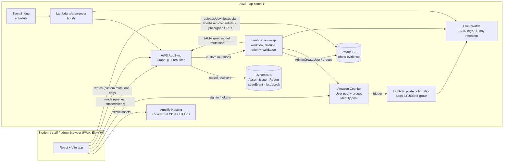

# Architecture

FixLoop is a serverless web app on AWS, built with **AWS Amplify Gen 2** (infrastructure as TypeScript code on AWS CDK). Region: **ap-south-1 (Mumbai)**, close to Indian users.

## 1. System diagram



## 2. Request flows

### Report (the core journey)
1. A student scans the QR → `https://<app>/a/H4-WC-01`. The asset loads with **guest** credentials (Cognito identity pool), so the scan resolves before sign-in.
2. After sign-in, the app lists the asset's issues (`issuesByAsset` index) and shows active ones: *"Is it one of these? Confirm instead."*
3. Optional photo: compressed on the phone to ≤1600 px JPEG (strips EXIF GPS, saves data), then uploaded straight to S3 at `reports/{identityId}/…`. IAM allows a student to write **only** into their own folder.
4. `reportIssue` mutation → AppSync → **issue-api Lambda**:
   - validates the asset code, issue type, text length and photo keys (S3 `HeadObject`: exists, image type, ≤5 MB);
   - rate-limits to 10 reports per account per hour;
   - **dedupe:** atomically claims `IssueLock(assetId#issueType)`. If an active issue holds the lock, the report becomes a **confirmation** (one per person, enforced by the Report id `issueId#sub`). If that issue is awaiting verification, it is **reopened**;
   - computes the **transparent priority score** and the **SLA due time**, routes to the **department** from the catalog, and writes an audit event.
5. All writes happen through AppSync (IAM-signed), so **subscriptions fire** and the staff queue and admin dashboard update live.

### Repair and verification
`issueAction` (ACCEPT → START → RESOLVE → VERIFY_FIXED / VERIFY_NOT_FIXED) runs through the shared **state machine** (`shared/workflow.ts`):
- Only staff in the routed department's Cognito group can accept.
- Only the assignee can start or resolve, and RESOLVE requires remarks plus an evidence photo (server-checked).
- **Only a reporter or confirmer can close an issue.** Staff can't.
- "Not fixed" reopens the issue with a fresh SLA and a higher priority.
- Writes use optimistic concurrency (`condition: status = expected`), so two staff can't accept the same task.

### Hourly SLA sweep
EventBridge → `sla-sweeper` Lambda:
- re-scores waiting issues, since the waiting time is part of the priority;
- marks missed targets and escalates them once (an event appears in the timeline and the admin "Overdue" list);
- auto-closes fixes with no reporter response after 72 h as `CLOSED_UNVERIFIED`. These are reported separately and never counted as verified.

## 3. Why these AWS services

| Need | Choice | Why (and the alternative considered) |
|---|---|---|
| Sign-in, roles | **Cognito** user pool + groups | Managed email verification, password reset, JWT groups in every request. Free up to 10k MAU. Rolling our own JWT auth (as the competitor repos do) is a security liability |
| API | **AppSync** (GraphQL) | Declarative per-model authorization (`allow.guest/authenticated/group/resource`), **real-time subscriptions** for the live dashboard, and a typed client. The alternative was API Gateway + Lambda, which AWS's decision guide recommends for plain sync APIs [S6]; that would need hand-written auth for every route and a separate WebSocket API for live updates |
| Business rules | **Lambda** (Node 22, arm64) | Dedupe, priority, the state machine and validation must be server-side and testable. One function handles all custom operations (fewer cold starts) |
| Data | **DynamoDB** (on-demand, via Amplify) | Serverless, single-digit-ms, no connections to manage, scales to zero cost. Access patterns are key-value plus a few indexes (by asset, status, department, reporter) |
| Photos | **S3** private bucket | Identity-scoped write paths, pre-signed reads, lifecycle rule for abandoned uploads |
| Scheduling | **EventBridge** schedule → Lambda | SLA escalation must run even when nobody opens the app |
| Hosting | **Amplify Hosting** | HTTPS + CDN + CI/CD from Git, and it deploys the backend in the same pipeline (`ampx pipeline-deploy`) |
| Observability | **CloudWatch** | Structured JSON logs with 30-day retention |

We deliberately did **not** use Amazon Bedrock or other AI services. Priority and asset insights are explainable rules (see `shared/priority.ts` and `shared/assetIntel.ts`). AI would add cost and opacity without enough historical data to justify it. Textract and similar ML services are also Paid-plan only [S4].

## 4. Code layout

```
amplify/                    Infrastructure as code (Amplify Gen 2)
  auth/                     Cognito: email login, groups, post-confirmation trigger
  data/resource.ts          AppSync schema + authorization rules
  storage/resource.ts       Private S3 bucket + access rules
  functions/issue-api/      Lambda: handler (resolver), service (rules), AppSync repo, AWS adapters, sweeper
  backend.ts                Wires everything; bucket lifecycle; password policy
shared/                     Pure TypeScript domain logic, used by Lambda AND browser
  catalog.ts                Departments, asset types, issue types (EN/HI), SLA hours
  priority.ts               Transparent priority score + SLA
  workflow.ts               State machine + role permissions
  dedupe.ts                 Duplicate-consolidation rule
  analytics.ts, assetIntel.ts  Dashboard metrics and asset rules
  demo.ts                   Labelled DEMO dataset
src/                        React app (student, staff, admin)
tests/                      Vitest: domain rules, service (in-memory repo), Lambda boundary
scripts/                    bootstrap-admin, production smoke test
```

**Design choice: the "hexagonal" service.** `IssueService` depends on a `Repo` interface. In Lambda it talks to AppSync; in tests it talks to an in-memory repo with the same conditional-write semantics. So every business rule is tested without AWS, and the same code runs in production.

## 5. Scalability

| Dimension | Today | At 100× (e.g. 50 campuses) |
|---|---|---|
| Users | Cognito 10k MAU free | Cognito scales to millions; cost about $0.0055/MAU above free on Lite (verify on the pricing page [S11]) |
| Writes | ~6 AppSync operations per report | DynamoDB on-demand scales automatically; Lambda concurrency default is 1,000 |
| Dashboard | `observeQuery` loads all issues (fine for thousands) | Move aggregates into a DynamoDB "stats" item updated by the Lambda, and paginate lists by `issuesByStatus` |
| Multi-campus | One deployment per campus (catalog per campus) | Add `campusId` to every model and a campus-scoped group, or keep one Amplify app per institution (stronger isolation) |
| Sweeper | Scans active issues via the `issuesByStatus` index hourly | Fine into the tens of thousands; then shard by department |

## 6. Hinglish mein samjho (key decisions, simply)

- **AppSync kyun, API Gateway kyun nahi?** Har model pe "kaun padh sakta hai, kaun likh sakta hai" ke rules ek jagah code mein likhe hain. Real-time subscriptions bhi free mein milte hain, isliye admin dashboard bina refresh ke update hota hai.
- **Lambda mein saara logic kyun?** Student ya staff browser se seedha database mein status nahi badal sakta. Har change Lambda se hota hai, jahan rules check hote hain: kaun accept kar sakta hai, photo zaroori hai ya nahi, sirf reporter hi close kar sakta hai. Isse koi bhi "Resolved" button dabake jhooth nahi bol sakta.
- **Duplicate kaise rokte hain?** Ek asset + ek problem type = ek hi active issue. DynamoDB mein ek "lock" record hota hai. Doosra student wahi problem report kare toh nayi complaint nahi banti, uski "confirmation" judti hai aur priority badhti hai. Ek insaan ek hi baar gina jaata hai.
- **Priority AI se kyun nahi?** Judges aur warden ko samajh aana chahiye ki P1 kyun hai. Isliye seedha formula hai: severity + problem type + confirmations + waiting time + asset ka importance + reopen. Har point UI mein dikhta hai.
- **Photos safe kaise hain?** S3 bucket private hai. Student sirf apne folder mein upload kar sakta hai. Dekhne ke liye 15 minute ka temporary link banta hai. Phone pe photo compress hoti hai, jisse location (EXIF) bhi hat jaati hai.
- **Free tier mein kaise rehte hain?** Sab kuch serverless hai: koi server 24×7 nahi chalta. Use hoga tabhi cost, aur pilot scale pe sab free limits ke andar hai (details `AWS_COST_AND_SECURITY.md` mein).
