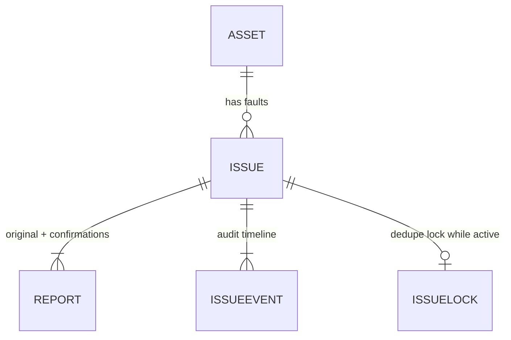

# Database Schema

Amazon DynamoDB tables generated by Amplify Data from `amplify/data/resource.ts`. Each model becomes one table with on-demand capacity. Amplify adds `createdAt`, `updatedAt` and `__typename` automatically.

## Entity overview

## Asset
The physical object behind a QR label.

| Field | Type | Notes |
|---|---|---|
| `id` | ID (PK) | Human-readable code printed under the QR, e.g. `H4-WC-01`. Regex `^[A-Z0-9][A-Z0-9-]{1,22}[A-Z0-9]$` |
| `name`, `nameHi` | String | English / Hindi display names |
| `assetType` | String | `WATER_COOLER`, `WASHROOM`, `CEILING_FAN`, `LIGHT`, `WIFI_AP`, `CLASSROOM` (see `shared/catalog.ts`) |
| `building`, `floor`, `locationLabel`, `locationLabelHi` | String | Location |
| `criticality` | Int 1–3 | 3 = only source on a floor or safety-related; adds 0/6/12 priority points |
| `status` | String | `ACTIVE` or `RETIRED` (retired assets refuse new reports, keep history) |
| `installedOn` | Date | Optional |
| `isDemo` | Boolean | **DEMO DATA flag.** Demo asset ids start with `DEMO-` |

**Authorization:** guest + authenticated **read**; `ADMIN` group full CRUD.

## Issue
One distinct fault on one asset. Contains **no reporter identity**.

| Field | Type | Notes |
|---|---|---|
| `id` | ID (PK) | UUID |
| `assetId`, `assetName`, `assetType`, `building`, `locationLabel` | String | Denormalised for lists and analytics |
| `issueType` | String | From the catalog, e.g. `NO_WATER` |
| `department` | String | `ELECTRICAL` · `PLUMBING` · `CIVIL` · `HOUSEKEEPING` · `IT` · `TRIAGE` |
| `severity` | String | `CRITICAL` · `HIGH` · `MEDIUM` · `LOW` (catalog default; a reporter can raise a safety-relevant type to CRITICAL) |
| `status` | String | `OPEN` · `ACKNOWLEDGED` · `IN_PROGRESS` · `RESOLVED` · `REOPENED` · `CLOSED` · `CLOSED_UNVERIFIED` · `INVALID` |
| `description`, `photoKeys[]` | String | Original report text and photo S3 keys |
| `priorityScore`, `priorityBand`, `priorityBreakdown` | Int, String, AWSJSON | Transparent score 0–100, band P1–P4 and per-component points |
| `confirmationCount`, `reopenCount`, `escalationLevel` | Int | Counters |
| `assetCriticality` | Int | Copied at report time |
| `reportedAt`, `lastOpenedAt`, `acknowledgedAt`, `startedAt`, `resolvedAt`, `closedAt`, `slaDueAt` | AWSDateTime | Lifecycle timestamps (all analytics use these) |
| `slaBreached` | Boolean | Set by the hourly sweeper |
| `assigneeSub`, `assigneeName` | String | Staff member who accepted |
| `resolutionRemarks`, `repairEvidenceKeys[]` | String | Required on RESOLVE (photo required unless the type is exempt, e.g. Wi-Fi) |
| `verificationOutcome`, `verificationRating`, `verificationComment` | String, Int, String | Reporter's verdict, 1–5 stars, comment |
| `declineReason`, `invalidReason` | String | Staff decline / admin invalidation reasons |
| `submitMs` | Int | Time from opening the asset page to submitting (pilot metric) |
| `isDemo` | Boolean | DEMO DATA flag |

**Global secondary indexes**

| Index (query field) | Partition | Sort | Used by |
|---|---|---|---|
| `issuesByAsset` | `assetId` | `reportedAt` | Asset page, asset history |
| `issuesByStatus` | `status` | `reportedAt` | SLA sweeper (active statuses only) |
| `issuesByDepartment` | `department` | `reportedAt` | Department views at scale |

**Authorization:** authenticated **read** only. No client can create, update or delete issues; all writes come from the `issue-api` and `sla-sweeper` Lambdas (IAM `allow.resource`).

## Report
One per person per issue: the original report or an independent confirmation.

| Field | Type | Notes |
|---|---|---|
| `id` | ID (PK) | `${issueId}#${reporterSub}`. **The primary key enforces "one person, one vote"** |
| `issueId`, `assetId` | String | |
| `reporterSub` | String | Cognito `sub` (opaque UUID, not the email) |
| `kind` | String | `ORIGINAL` · `CONFIRMATION` |
| `note`, `photoKeys[]`, `submitMs`, `submittedAt` | | |
| `verification`, `verifiedAt` | String, DateTime | `FIXED` / `NOT_FIXED` |
| `isDemo` | Boolean | |

**Indexes:** `reportsByIssue` (issueId), `reportsByReporter` (reporterSub, submittedAt).
**Authorization:** `ADMIN` read only. Students see their own reports via the `myReports` query, which the Lambda filters by the caller's token `sub`.

## IssueEvent (immutable audit timeline)

| Field | Type | Notes |
|---|---|---|
| `issueId` | String | Index `eventsByIssue` (issueId, at) |
| `type` | String | `REPORTED`, `CONFIRMED`, `ACCEPT`, `DECLINE`, `START`, `RESOLVE`, `VERIFY_FIXED`, `VERIFY_NOT_FIXED`, `REASSIGN`, `MARK_INVALID`, `AUTO_CLOSE`, `ESCALATED` |
| `fromStatus`, `toStatus` | String | |
| `actorRole` | String | `STUDENT` · `STAFF` · `ADMIN` · `SYSTEM` |
| `actorName` | String | Staff/admin display name. **Always null for students** |
| `note`, `evidenceKeys[]`, `at`, `isDemo` | | |

**Authorization:** authenticated read; written only by Lambda.

## IssueLock (dedupe)

| Field | Type | Notes |
|---|---|---|
| `id` | ID (PK) | `${assetId}#${issueType}` |
| `issueId` | String | The active issue holding the lock |

Created with a conditional put (fails if it exists), so two simultaneous reports of the same fault cannot create two issues. Released when the issue reaches `CLOSED`, `CLOSED_UNVERIFIED` or `INVALID`. Free-form "Something else" reports never take a lock. **Authorization:** `ADMIN` read; Lambda write.

## Access-pattern summary

| Question | How it is answered |
|---|---|
| What is this QR? | `Asset.get(id)` (guest allowed) |
| What's already broken here? | `issuesByAsset(assetId)` |
| Is this a duplicate? | `IssueLock.get(assetId#type)` → `Issue.get` |
| Has this person already reported it? | `Report.get(issueId#sub)` |
| My reports | `reportsByReporter(sub)` inside the Lambda |
| Department queue / dashboard | `Issue.observeQuery()` (live) |
| What needs escalation? | `issuesByStatus` for each active status (sweeper) |
| Timeline | `eventsByIssue(issueId)` |

## Data retention and privacy
- No phone numbers or roll numbers are collected. The email lives only in Cognito.
- Reporter identity (`reporterSub`) lives only in `Report`, readable by admins (needed for abuse handling) and never shown to staff or other students.
- Photos are private. Clients re-encode them, which strips EXIF GPS metadata.
- Demo data is fully removable from **Admin → Data → Clear demo data**.
